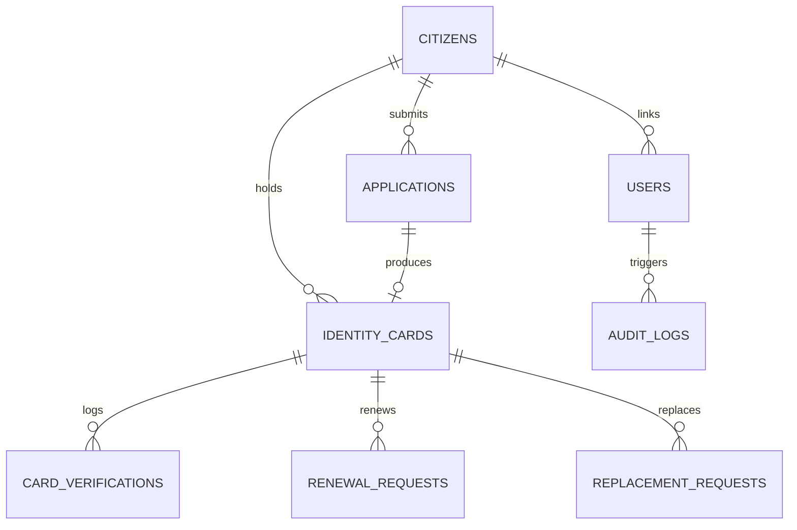

# Smart NIC – National Identity Card Management and Verification System

**Academic Prototype | Minor Project (EC486)**  
**Technology Stack:** Python 3.11+, Streamlit, FastAPI, SQLite3, Pillow, QRCode, OpenCV, Pandas, Plotly, FPDF, Bcrypt, Pytest  

> **Academic Prototype Disclaimer:** This system is an academic software prototype developed for educational demonstration. All citizens, identity numbers (`SNIC-YYYY-XXXXXX`), photographs, and credentials are **100% fictional**. It does not reproduce official government seals and must not be represented as an official government identity issuance platform.

---

## 1. Abstract

Conventional paper and magnetic-stripe identity credentials are vulnerable to forgery, duplication, and manual verification delays, and they leave no digital audit trail when checked. **Smart NIC – National Identity Card Management and Verification System** is a secure, web-based digital identity platform built with Python, Streamlit, FastAPI, and SQLite. It streamlines end-to-end citizen registration, duplicate detection, administrator application review, ISO/IEC 7810 ID-1 proportioned Front & Back Smart NIC card generation with PDF/print export, privacy-preserving cryptographic QR verification (`VALID`, `EXPIRED`, `REVOKED`, `INVALID`, `NOT FOUND`), card lifecycle/renewal/replacement management, and role-based audit logging. Automated verification across 10 end-to-end test suites confirms 100% pass rates across RBAC enforcement, QR round-trip decoding, credential revocation, and API security.

---

## 2. Introduction & Problem Statement

### 2.1 Existing System Limitations
- Manual paper-based registration leads to duplicate applications, inconsistent formatting, and slow verification.
- Visual-only ID cards provide no automated mechanism to detect expired, forged, or revoked credentials.
- Unprotected QR codes that embed raw personal details (phone, address, email) expose sensitive citizen PII to anyone scanning the card.

### 2.2 Proposed System
Smart NIC replaces manual workflows with a centralized, role-protected digital identity platform:
1. **Strict Role-Based Access Control (RBAC):** Separate **Administrator Portal** (12 pages), **Citizen Self-Service Portal** (6 pages with strict record isolation), and an unauthenticated **Public QR Verification Portal**.
2. **Privacy-Preserving QR Verification:** QR codes store ONLY an opaque cryptographically signed verification token (`SNICV1|<random_token>|<hmac_sig>`) — never sensitive personal data.
3. **Full Credential Lifecycle:** Supports registration, `Pending` → `Under Review` → `Approved`/`Rejected` application processing, Front & Back Smart NIC rendering + PDF download, activation/deactivation/revocation, and renewal/lost/damaged replacement (automatically revoking superseded credentials).

---

## 3. System Architecture & Diagrams

### 3.1 Architecture Overview
```
┌──────────────────────────────────────────────────────────────────────┐
│                       PRESENTATION LAYER                             │
│  Streamlit Multi-Portal UI (app.py + views/)  |  FastAPI REST (api.py)│
│  • Admin Portal (12 Pages)                                           │
│  • Citizen Self-Service Portal (6 Pages, strict data isolation)      │
│  • Public QR Verification Portal (Camera / Upload / Manual Entry)    │
└───────────────────────────────┬──────────────────────────────────────┘
                                │
┌───────────────────────────────▼──────────────────────────────────────┐
│                     BUSINESS SERVICE LAYER (modules/)                │
│  auth_service      (bcrypt, HMAC tokens, lockouts, rate limiting)    │
│  citizen_service   (validation, duplicate check, photo storage)      │
│  application_service (Pending -> Under Review -> Approve/Reject)     │
│  card_service      (NIC generation, Active/Revoked/Expired, Renew)   │
│  qr_service        (QRCode gen, OpenCV QRCodeDetector, HMAC verify)  │
│  card_renderer     (Pillow Front/Back CR80 PNG + FPDF card PDF)      │
│  report_service    (Live KPIs, 6 date-filtered reports, CSV/PDF)     │
└───────────────────────────────┬──────────────────────────────────────┘
                                │
┌───────────────────────────────▼──────────────────────────────────────┐
│               DATA & STORAGE LAYER (SQLite3 + Photos)                │
│  9 Normalized Tables: users, citizens, applications, identity_cards, │
│  card_verifications, renewal_requests, replacement_requests,         │
│  audit_logs, system_settings                                         │
└──────────────────────────────────────────────────────────────────────┘
```

### 3.2 Entity-Relationship (ER) Diagram


### 3.3 Use-Case Overview
- **Public Verifier (No Login Required):** Scan QR via webcam / uploaded card image or enter NIC code → view limited credential status (`VALID` / `EXPIRED` / `REVOKED` / `INVALID` / `NOT FOUND`).
- **Citizen:** Register profile, log in, view application status, download Front/Back/PDF Smart NIC, request renewal, report lost/damaged card, view own verification history, update permitted contact details.
- **Administrator:** View live KPI dashboard & charts, manage citizens, review/approve/reject applications, generate/print Smart NICs, activate/deactivate/revoke cards, process renewals & replacements, export CSV/PDF reports, inspect audit logs, manage users & settings.

---

## 4. Database Architecture (9 SQLite Tables)

| # | Table | Purpose & Key Constraints |
| :--- | :--- | :--- |
| 1 | `users` | Admin & Citizen accounts (`username`, `email` UNIQUE, `bcrypt` `password_hash`, `role`, lockout tracking) |
| 2 | `citizens` | Citizen profiles (`citizen_code`, `email` UNIQUE, personal details, photo path, `ACTIVE`/`INACTIVE`) |
| 3 | `applications` | Identity applications (`application_id` UNIQUE, `Pending`/`Under Review`/`Approved`/`Rejected`, rejection reason) |
| 4 | `identity_cards` | Issued Smart NICs (`nic_number` UNIQUE, `verification_token` UNIQUE, `token_signature`, `ACTIVE`/`INACTIVE`/`REVOKED`/`EXPIRED`) |
| 5 | `card_verifications` | Every QR scan & manual lookup result (`VALID`, `EXPIRED`, `REVOKED`, `INVALID`, `NOT FOUND`) |
| 6 | `renewal_requests` | Citizen renewal submissions linked to old card and newly issued renewed card |
| 7 | `replacement_requests` | `LOST` / `DAMAGED` replacement workflow revoking old credential and preserving history |
| 8 | `audit_logs` | Immutable security & administrative event trail |
| 9 | `system_settings` | Configurable validity years, lockout thresholds, rate limits, and prototype disclaimers |

---

## 5. REST API Endpoints (`api.py`)

| Method | Endpoint | Access | Description |
| :--- | :--- | :--- | :--- |
| `GET` | `/api/health` | Public | Service health check |
| `POST` | `/api/auth/login` | Public | Admin/Citizen login (returns signed Bearer token) |
| `GET` | `/api/auth/me` | Authenticated | Current user profile |
| `POST` | `/api/verify` | **Public** | Verify QR payload or NIC number (returns minimal safe info) |
| `POST` | `/api/citizens/register` | Public | Register citizen & create `Pending` application |
| `GET` | `/api/citizens` | Admin | Search & filter all citizens |
| `GET/PUT` | `/api/citizens/{id}` | Admin / Own Citizen | View or update profile (strict citizen isolation) |
| `PATCH` | `/api/citizens/{id}/status` | Admin | Activate / deactivate citizen account |
| `GET` | `/api/applications` | Admin / Own Citizen | List applications |
| `POST` | `/api/applications/{id}/review` | Admin | Mark application `Under Review` |
| `POST` | `/api/applications/{id}/approve` | Admin | Approve application & issue Smart NIC |
| `POST` | `/api/applications/{id}/reject` | Admin | Reject application with reason |
| `GET` | `/api/cards` | Admin / Own Citizen | List issued Smart NIC cards |
| `POST` | `/api/cards/issue` | Admin | Issue new Smart NIC credential |
| `PATCH` | `/api/cards/{id}/status` | Admin | Activate / Deactivate / Revoke card |
| `GET` | `/api/cards/{id}/pdf` | Admin / Own Citizen | Download print-ready Smart NIC PDF |
| `GET/POST` | `/api/renewals` | Admin / Own Citizen | List or submit renewal requests |
| `POST` | `/api/renewals/{id}/decision` | Admin | Approve or reject renewal request |
| `GET/POST` | `/api/replacements` | Admin / Own Citizen | List or submit lost/damaged requests |
| `POST` | `/api/replacements/{id}/decision` | Admin | Approve or reject replacement request |
| `GET` | `/api/reports/dashboard` | Admin | Live KPI dashboard metrics |
| `GET` | `/api/reports/{report_type}` | Admin | JSON or CSV operational reports with date filters |
| `GET` | `/api/audit-logs` | Admin | Query audit trail |
| `GET/POST` | `/api/users` | Admin | List or create user accounts |
| `PATCH` | `/api/users/{id}/status` | Admin | Activate or deactivate user accounts |

---

## 6. Installation & Execution

### 6.1 Install Dependencies
```bash
pip install -r requirements.txt
```

### 6.2 Optional Environment Variables
```bash
SMART_NIC_DB_PATH=data/smart_nic_identity.db
SMART_NIC_SECRET_KEY=<your-random-session-secret>
SMART_NIC_QR_KEY=<your-random-qr-hmac-secret>
```

### 6.3 Run Streamlit Web Application
```bash
streamlit run app.py
```
Opens at `http://localhost:8501`.

### 6.4 Run FastAPI REST Backend (Optional Parallel Server)
```bash
uvicorn api:app --reload --port 8000
```
Interactive Swagger API docs available at `http://localhost:8000/docs`.

---

## 7. Demo Login Credentials (100% Fictional)

| Role | Username | Password | Demo Scenario |
| :--- | :--- | :--- | :--- |
| **Administrator** | `admin` | `Admin@123` | Full 12-page Admin Portal access |
| **Citizen (Active)** | `aarav.sharma` | `Citizen@123` | Active Smart NIC (`SNIC-2026-840137`) |
| **Citizen (Active + Renewal)** | `priya.desai` | `Citizen@123` | Active Smart NIC + Pending Renewal |
| **Citizen (Expired)** | `kabir.mehta` | `Citizen@123` | Expired Smart NIC (`SNIC-2026-840411`) |
| **Citizen (Revoked)** | `meera.nair` | `Citizen@123` | Revoked Smart NIC (`SNIC-2026-840548`) + Lost Replacement |
| **Citizen (Pending)** | `rohan.verma` | `Citizen@123` | Pending Application awaiting Admin review |

---

## 8. Automated Testing

Run the full automated verification suite:
```bash
pytest -v
```
All 10 test suites verify database schema, bcrypt password hashing, duplicate detection, photo validation, RBAC enforcement, Front/Back card rendering & PDF generation, OpenCV QR round-trip verification (`VALID`, `EXPIRED`, `REVOKED`, `INVALID`, `NOT FOUND`), renewal/replacement revocation, citizen data isolation, CSV/PDF reports, and FastAPI endpoints.

---

## 9. Limitations & Future Scope

### Limitations
- Academic prototype using local SQLite storage and fictional data; not certified for production government issuance.
- Rate limiting is in-memory per process (production deployments should use Redis).

### Future Scope
- Hardware RFID/NFC smart-card reader integration (e.g., ISO/IEC 14443 DESFire EV3 / MFRC522 bridge).
- Biometric second-factor verification (fingerprint/facial match during issuance).
- Asymmetric Ed25519 / PKI certificate signing for offline public-key QR verification.
